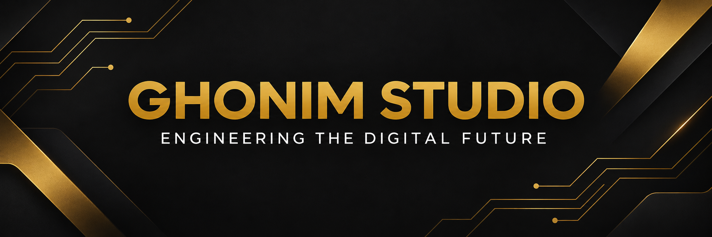

# GHONIM STUDIO

### ENGINEERING THE DIGITAL FUTURE

**Software Engineering · Digital Products · Technology Solutions**

---

## About Us

Ghonim Studio is a software development studio focused on building modern, secure, and scalable digital solutions.

We transform ideas into reliable digital products through thoughtful design, clean architecture, and modern engineering practices.

## What We Do

| Expertise | Solutions |
| :--- | :--- |
| Web Development | Modern web applications and platforms |
| Mobile Development | Cross-platform mobile applications |
| Backend Engineering | Scalable APIs and secure systems |
| UI/UX Design | Modern digital experiences |
| Cloud & DevOps | Infrastructure and deployment automation |

## Our Technology Stack

## Engineering Principles

- Clean and maintainable architecture
- Security by design
- Performance and scalability
- Continuous improvement
- User-centered product development

---

**BUILD WITH PURPOSE. ENGINEER WITH PRECISION.**

© 2026 Ghonim Studio

